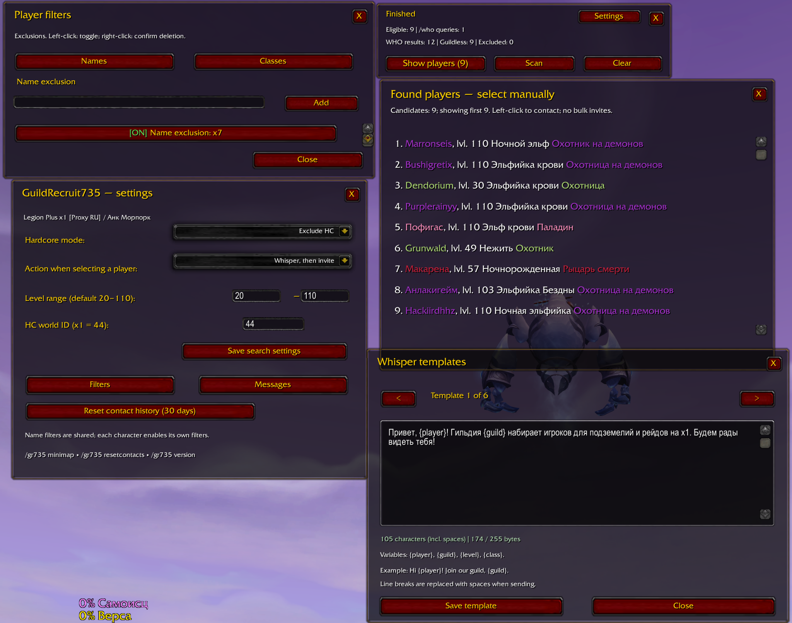
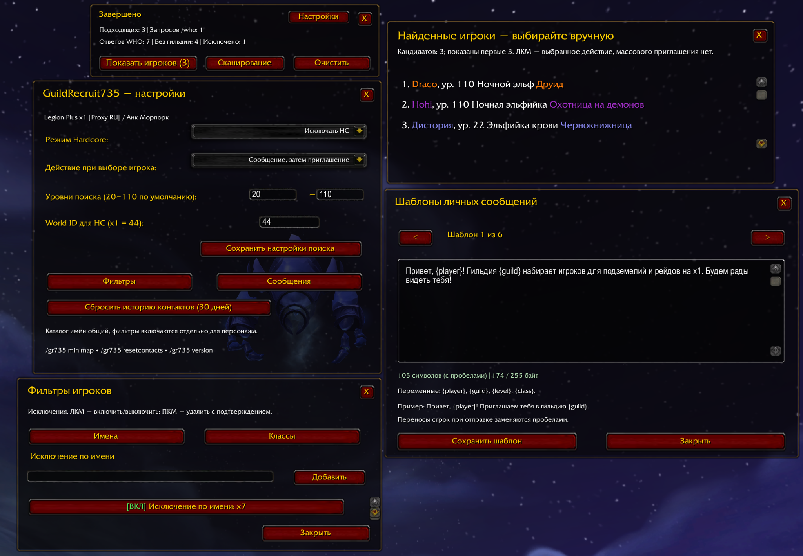

# GuildRecruit735 — English

**Version 1.0.0** · **World of Warcraft Legion 7.3.5** · Interface **70300** · **MIT license**

GuildRecruit735 is an independently written assistant for **manual guild recruitment**. The principal observed target is **Legion Plus / UWoW x1**. This is **not** a fork of SuperGuildInvite and includes no third-party addon code, graphics or libraries.

[Русская документация](README.md) · [Changelog](CHANGELOG.md) · [Known limitations](docs/KNOWN_LIMITATIONS.en.md) · [License](LICENSE)

## Features

- Deliberately initiated, bounded `/who` searches; level range, progress counters and a candidate list. **No bulk or automated invitations.**
- Name and class exclusions. Named filter catalogue shared within the WoW account, enabled separately for each character and guild.
- Hardcore recruitment options (exclude HC / only HC / all) with conservative handling of unknown status. The initially configured x1 HC World ID is 44.
- Choose a candidate manually to **invite only**, **whisper then invite**, or **whisper only**. Six editable templates support `{player}`, `{guild}`, `{level}`, `{class}`.
- Thirty-day *attempted-contact* cooldown, with confirmation before resetting the current character/guild profile's history.
- Round minimap button: left-click opens or closes the main UI, right-click opens settings; observed with MinimapButtonBag.
- Russian/English UI with automatic client-language selection or manual override.

## Screenshots

*These are unmodified screenshots of the preceding 0.1.5 English and 0.1.4 Russian test versions, not falsely labelled screenshots of the 1.0.0 build. The 1.0.0 change is release metadata/docs only.*

## Installation

1. Close WoW completely. Optionally back up `GR735DB.lua` and `GR735CharDB.lua` from your `WTF` configuration; **do not delete your WTF folder**.
2. Extract the installation ZIP to `World of Warcraft/Interface/AddOns/`, producing `Interface/AddOns/GuildRecruit735/GuildRecruit735.toc`.
3. Open the UI via its minimap icon or `/gr735`; confirm `/gr735 version` reports **`1.0.0 / GR735-20261014-03`**.
4. Start a manual WHO scan and explicitly select candidates; there is no automatic mass invite.

## Commands

- `/gr735` — main panel; `/gr735 options` — settings; `/gr735 filters` — filters; `/gr735 messages` — templates.
- `/gr735 scan`, `/gr735 stop` — start/stop WHO scan.
- `/gr735 minimap` — hide/restore minimap icon.
- `/gr735 resetcontacts` — confirm reset for the active character/guild profile.
- `/gr735 lang ru|en|auto` — set addon UI language; use `/reload` afterward.
- `/gr735 version` — print version and build ID.

## Compatibility and limitations

`GR735DB` and `GR735CharDB` keep the same SavedVariables identities/schema across the addon's own previous versions. Switching UI language never translates or overwrites user-created templates, filter values, character names or race/class strings returned by the client/server.

Pre-release user evidence on x1 supports basic manual WHO, a working minimap launcher and an actually delivered whisper plus invitation. The English UI was shown working on 0.1.5-TEST. **All HC modes, x100/cross-realm correctness, exhaustive WHO behavior and every reload scenario are not comprehensively game-verified.** See [known limitations](docs/KNOWN_LIMITATIONS.en.md).

## Credits and license

Original independent project by GuildRecruit735 contributors, released under the [MIT license](LICENSE). No SuperGuildInvite or other addon source is bundled. Warcraft screenshots contain Blizzard game visuals and are not licensed as part of the MIT-covered Lua code.
