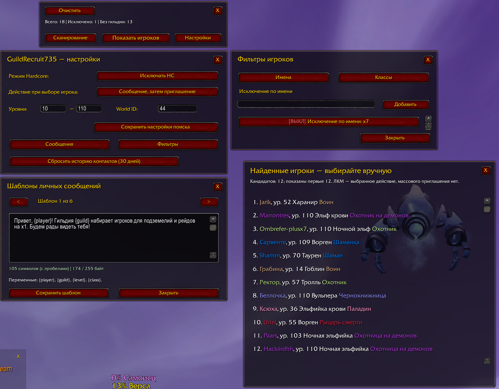

# GuildRecruit735 1.0.7 — исправление загрузки функций

Сборка GR735-20261019-02, Legion 7.3.5 / Interface70300. Предварительный релиз.

Исправлены ошибки UI.lua:418 RebuildCandidates и UI.lua:162 ScanDetailsText: функции перенесены из нового Selection.lua в существующий Scanner.lua. Selection.lua оставлен совместимым пустым файлом. Теперь код работает и при загрузке по прежнему списку файлов без Selection.lua.

Журнал 19.10.2026 подтверждает ошибки 1.0.6; отсутствие загрузки нового файла воспроизведено в модели. Установленные 13 файлов совпадали с опубликованной 1.0.6. Причина отсутствия модуля в конкретном игровом сеансе пока не подтверждена; полный перезапуск после установки обязателен.

Настройки, история, фильтры и сама логика отбора сохранены. Все изменения 1.0.6 включены.

Проверки: 11 Lua-файлов, RU/EN по798проверок на Lua5.1 и LuaJIT2.1, обычная загрузка и загрузка без Selection.lua (8прогонов). Статика не заменяет игровую проверку; exact107 GAME_NOT_OBSERVED.

Установка: полностью закрыть WoW, заменить папку GuildRecruit735 из ZIP без SOURCE, сохранить WTF. Запустить WoW заново и проверить /gr735 version. Проверить открытие мини-панели, подсказку статуса и запуск поиска.

SHA256 install: 67f05cff8fabf176242d3ba8302be8f0d56355c424fb48c6eb791d9f53ed46b1.
Релиз1.0.6 и старые версии сохранены по команде пользователя.

--- Historical notes ---

# GuildRecruit735 1.0.6

**WoW Legion 7.3.5 / Interface 70300** · **Сборка GR735-20261019-01** · **MIT**

Предварительная версия для игровой проверки. Проверка новой логики в реальном клиенте ещё не подтверждена.

Исправлена логика сканирования и отбора кандидатов:

- Все найденные кандидаты доступны страницами по 30. Сохранены стрелки, колесо мыши, ползунок и растягивание окна из 1.0.5.
- Исключения `x7` и `plusx7` проверяют точный мир, а не совпадение внутри ника. Обычные фрагменты имён сохраняют прежнее назначение.
- Сканер, список и ручной контакт используют общую проверку. Смена фильтра перестраивает уже полученные данные и останавливает активный поиск; для нового диапазона нужен перезапуск.
- Имена HC и история контактов сопоставляются с учётом мира, без объединения одноимённых персонажей разных миров.
- Ответы `/who` проверяются до приёма; переполненный уровень дополнительно разделяется по классам при поддержке клиента. Таймауты, лимиты и неполнота отображаются явно.
- `/gr735 status` показывает подробности поиска; `/gr735 why Имя-мир` объясняет отбор полученного игрока.

**Установка:** закрыть WoW, заменить папку `GuildRecruit735` из установочного ZIP, сохранить WTF/SavedVariables. Проверить `/gr735 version`. ZIP с `SOURCE` в имени предназначен для разработчиков. Настройки, шаблоны, ID фильтров и история контактов сохраняются.

**Проверки:** 11 Lua-файлов; по 798 проверок RU/EN на Lua 5.1 и LuaJIT 2.1; 81 локальная статическая и пакетная проверка. Публикация повторяет проверки на нативном Lua 5.1 и сверяет точный SHA установочного ZIP.

**Ограничения:** полного охвата всех онлайн не обещаем. Сохранены интервал 8 секунд, таймаут 45 секунд и максимум 120 запросов; предел снимка 5000 игроков отмечается как неполнота. История контактов действует 30 дней от попытки, а не подтверждённой доставки. Реклама в общий чат и автоматические приглашения не добавлены. Причина двух исторических пропусков не доказана без сырых ответов `/who`.

**SHA-256 установочного ZIP:** `039850dc1d81ab87f413f27bf78b88b53bd9155ef96e681be47eb40e2702174c`.

Скриншоты в репозитории относятся к прежним версиям; нового снимка 1.0.6 пока нет.

[English notes](docs/RELEASE_NOTES_EN.md) · [Проверка и ограничения](docs/SCAN_TEST_1_0_6_RU.md)

--- Historical development notes ---

# GuildRecruit735 1.0.6 — GR735-20261019-01

Сборка для проверки новой логики сканирования на личном Drive. GitHub-релиз не изменён.

Исправления: все найденные кандидаты доступны страницами по30; точные исключения миров; общий отбор сканера/списка/контакта; перестроение снимка после смены фильтров; совместимые именаHC/контактов в пределах своего мира; проверкауровня/классаWHOответа; явный статус/причины и ограниченное дополнительное дробление переполненного уровня по классам. Сохранены ручные контакты, история30дней, настройки, шаблоны и прежняя прокрутка/растягивание105.

Подробная проверка/установка/ограничения: [SCAN_TEST_1_0_6_RU](docs/SCAN_TEST_1_0_6_RU.md). Команды: `/gr735 version`, `/gr735 status`, `/gr735 why Имя-мир`.

Статус: TEST_CANDIDATE / STATIC_VERIFIED / READY_FOR_GAME_TEST. GAME_NOT_OBSERVED. Прежние скриншоты и игровые принятия ниже — история, не проверка106. Нет обещания полного охвата всех онлайн или доставки приглашения.

--- История предыдущих этапов ---

# Исправление 1.0.5 — GR735-20261016-01

Исправлено управление списком игроков: отдельные обработчики стрелок, ползунка и колеса мыши, включая строки игроков. Добавлена ручка изменения размера справа внизу. Высота больше не сбрасывается при обновлении списка; ширина строк следует за окном. Действующий предел 30 отображаемых кандидатов сохранён. Размер сохраняется при обновлении и закрытии/открытии в текущем сеансе, не записывается в SavedVariables.

Статус: HOTFIX_CANDIDATE / STATIC_VERIFIED / GAME_RETEST_PENDING. Номер 1.0.5 без суффикса TEST; публикация релиза ещё не выполнялась. Пользователь сообщил о неисправности окна в предыдущей сборке; прежнее принятие интерфейса не подтверждает новые элементы управления. Скриншот ниже относится к 1.0.4.

Проверка в игре: открыть список с переполнением, нажать обе стрелки, прокрутить колесом над строкой и пустой частью, перетащить ползунок до конца; потянуть нижний правый угол, обновить список и открыть окно повторно. После установки выполнить /reload. Настройки и история контактов сохранены.

---

# GuildRecruit735

**Версия 1.0.4** · WoW **Legion 7.3.5** · Interface **70300** · **MIT**

GuildRecruit735 — самостоятельный аддон для ручного подбора игроков в гильдию. Поддерживает русский и английский интерфейс. Поиск и контакт запускаются пользователем; массовых и автоматических приглашений нет.

[English](README.en.md) · [Изменения](CHANGELOG.md) · [Ограничения](docs/KNOWN_LIMITATIONS.md) · [MIT](LICENSE)

## Интерфейс 1.0.4

Скриншот предоставлен пользователем после проверки интерфейса на непосредственной тестовой основе релиза. Версия 1.0.4 меняет в установленном аддоне только номер версии и ID сборки относительно этой основы.

- Компактная панель: «Очистить», три счётчика, «Сканирование/Стоп», «Показать игроков», «Настройки».
- Настройки открываются снизу с выравниванием справа. Сообщения пристыкованы ниже, фильтры — справа. Обе дочерние панели можно держать открытыми одновременно.
- Повторный клик по «Настройки» или её крестик закрывает всю связанную группу. Сообщения и фильтры переключаются независимо. Доки перемещаются вместе с мини-панелью и подстраиваются под доступный экран.
- Список игроков — отдельное свободно перемещаемое окно. Закрытие настроек его не скрывает.
- Фильтры: вкладки «Имена» и «Классы», все 12 классов; до четырёх видимых строк имён, остальные доступны прокруткой. Включение — ЛКМ, удаление из общего каталога — ПКМ с подтверждением. Число сохранённых фильтров не ограничивается четырьмя.
- Шесть шаблонов, явное сохранение, Unicode/UTF-8 счётчик и лимит 255 байт, переменные `{player}`, `{guild}`, `{level}`, `{class}`. Черновик не теряется при переключении панелей; для сохранения после `/reload` нажмите «Сохранить шаблон».

## Поиск и настройки

Ручной ограниченный WHO-поиск, диапазон 20–110 по умолчанию с сохранением введённых уровней 1–110. Три HC-режима и три способа контакта. Неопределённый HC-статус сохраняет обязательное подтверждение. World ID 44 — настройка исходного целевого мира x1.

Именной каталог общий для WoW-аккаунта, включение и классы — отдельно для персонажа/гильдии. История попыток контакта исключает повторное обращение на 30 дней. «Очистить» сбрасывает только сканирование; сброс истории требует отдельного подтверждения. Настройки, шаблоны и WTF при обновлении сохраняются.

## Установка

1. Закройте WoW и скачайте **установочный ZIP** из [Releases](https://github.com/JustAlex888/GuildRecruit735/releases/latest).
2. Замените папку `Interface/AddOns/GuildRecruit735` папкой из ZIP. Не удаляйте WTF.
3. Откройте аддон кнопкой мини-карты или `/gr735`; `/gr735 version` показывает версию и сборку.

ЛКМ по мини-карте — основная панель, ПКМ — настройки. Команды: `/gr735 options`, `/gr735 filters`, `/gr735 messages`, `/gr735 scan`, `/gr735 stop`, `/gr735 minimap`, `/gr735 resetcontacts`, `/gr735 lang ru|en|auto` (смена языка после `/reload`).

## Проверки

Пользователь принял внешний вид, работу интерфейса и фильтров на основе релиза. Доступны реальные скриншоты с результатами WHO и списком кандидатов. Статические и RU/EN регрессионные тесты входят в репозиторий; GitHub Actions проверяет нативный Lua 5.1 и воспроизводимую упаковку. Это не полное подтверждение всех HC/боевых/taint/x100/межсерверных сценариев. Подробности: [ограничения](docs/KNOWN_LIMITATIONS.md).

Оригинальная независимая реализация MIT, без исходников, библиотек или графики SuperGuildInvite и других аддонов.
